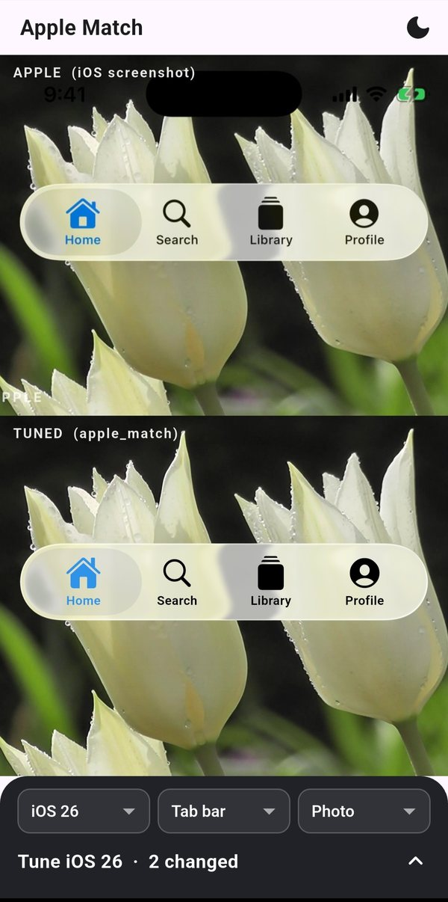
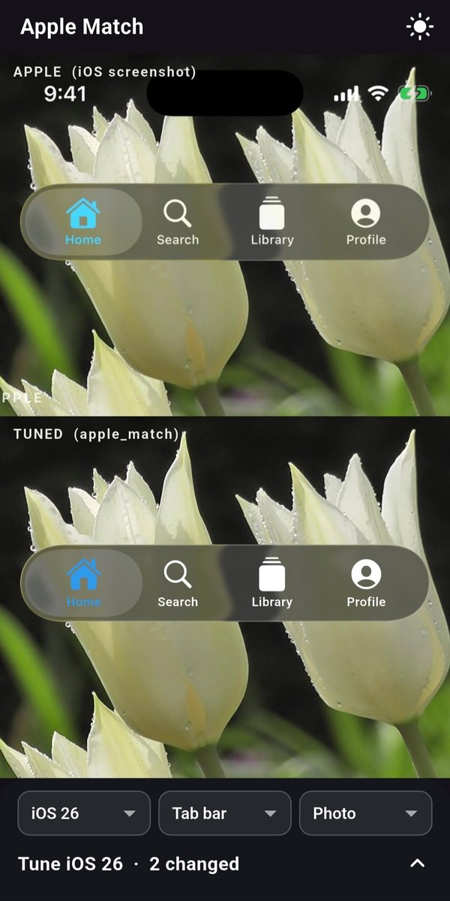

# Liquid Glass Easy — fine-tuning to match iOS 26 / 27

This branch is where `liquid_glass_easy` is tuned to look and behave like Apple's
Liquid Glass. The values found here will become a **new kit of iOS 26–27
components**, so every suggestion, fix and measured value helps.

> **Full disclosure:** I don't have an iPhone or a Mac. Everything here is matched
> from videos, images and iOS simulator screenshots. If you have a real device,
> your eyes are worth more than mine.

## The tuner

`example/` is one page, **Apple Match**: each component sits under Apple's own,
over the same background, with a panel that changes every value live.

```bash
cd example
flutter pub get
flutter run
```

- On **iOS and macOS** the top band is Apple's **live** control (through
  `cupertino_native`). Everywhere else it is an iOS 26 simulator screenshot.
- Pick the iOS release, the component and the background from the top row.
- **Copy** gives the component's code with your values written in; **Copy all**
  does every component.

<p>
  
  
</p>

## How to contribute

- **Fine-tuning:** tune a component until it matches, tap **Copy**, and open an
  issue or a PR with the code, a side-by-side screenshot, your device and the iOS
  version. Tuned starting values live in `example/lib/apple_match/presets/`.
- **iOS 27:** its preset is still a copy of iOS 26 and it has no screenshots yet.
  Screenshots go in `example/assets/apple_match/reference/ios27/` (names in the
  README there).
- **Enhancements:** fixes to the glass itself (`lib/`) are welcome as PRs; please
  say what you compared against.
- **Suggestions:** open an issue, even with a short video of the real thing.

## Open questions — help wanted

1. **Glass colour in dark mode:** is there a saturation boost, or only a tint? Over
   coloured stripes Apple's dark glass looks more saturated than a plain grey
   layer would give.
2. **What decides the glass colour:** in both modes, how does it change with what
   is behind it? Over a dark page and a bright photo, one fixed dark-grey layer
   (about `rgba(27, 28, 31, 146)`) fits our dark screenshots, but nothing confirms
   it holds everywhere.
3. **Tab bar on iOS 27:** does the selection pill still grow and lift when you tap
   an item, as on iOS 26?
4. **Tab bar dragging:** can you drag the pill straight away, or only after
   tap-and-hold?
5. **Dynamic adaptivity:** does the glass switch between light and dark on its own
   by what is behind it, as Apple's showcases suggest, and when?

## Components to create next

Ideas for the kit; say which you need most, or suggest your own:

- Segmented control
- Toolbar and navigation bar (with large title)
- Search field / tab bar search tab
- Menus, context menus and popovers
- Sheets with detents
- Stepper and steppers in lists
- Bottom accessory above the tab bar (e.g. a mini player)

---

The released package and its docs are on
[pub.dev](https://pub.dev/packages/liquid_glass_easy) and the
[documentation site](https://ahmeedgamil.github.io/liquid_glass_easy/).
